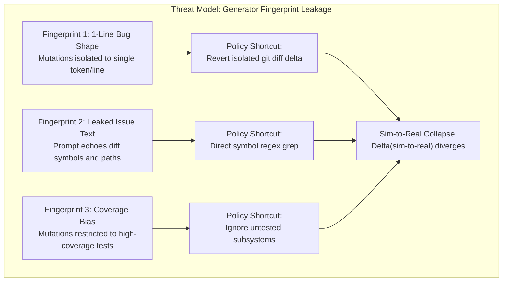
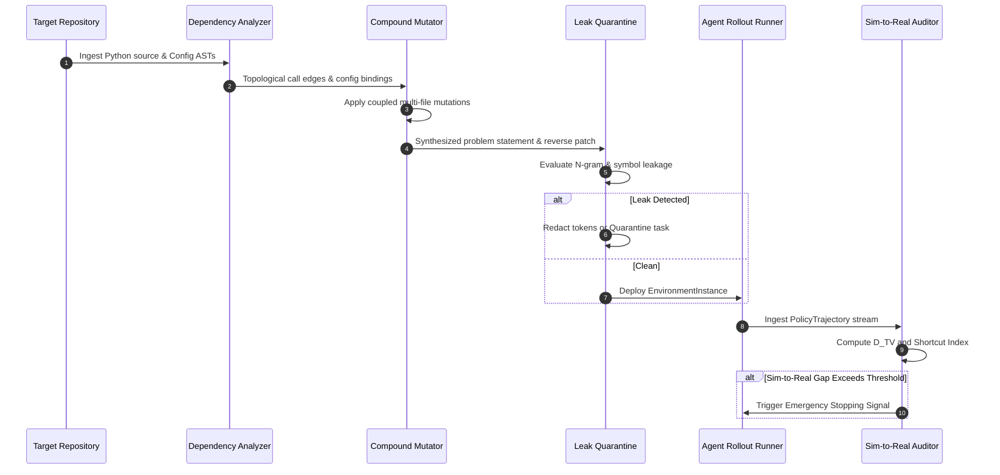

# System Architecture and Failure Mode Mitigations

This document details the engineering architecture, mathematical threat model, and subsystem dataflows of Mutant-RL.

---

## 1. Threat Model: Generator Fingerprint Leakage and Shortcut Learning

In software engineering reinforcement learning (SWE-RL), environments simulate software maintenance tasks where an agent policy $\pi_\theta$ interacts with a bash execution environment and repository filesystem. The reward function $R(\tau) \in \{0, 1\}$ is typically binary, determined by the execution of a test harness.

When synthetic tasks are generated via unconstrained procedural mutations, the generator introduces structural artifacts known as **Generator Fingerprints**. Reinforcement learning algorithms rapidly discover heuristic shortcuts that satisfy the reward function without acquiring generalized programming reasoning.

### Failure Mode 1: 1-Line Bug Shape
- **Etiology**: Traditional mutation operators (e.g., swapping binary operators, negating conditionals, deleting statements) operate at a localized AST node.
- **Vulnerability**: Policies learn to inspect recent git commits or local diffs and revert the singular strange line (`git checkout` or 1-line overwrite).
- **Mutant-RL Mitigation**: The `CompoundMutationEngine` analyzes cross-file AST dependencies and configuration files. Mutations must span multiple files or code-configuration interfaces.

### Failure Mode 2: Leaked Issue Text
- **Etiology**: Generating task problem descriptions by passing the ground-truth diff into an LLM prompts the model to restate modified function signatures, line numbers, and variable names.
- **Vulnerability**: The policy bypasses codebase search and exploration by grepping the exact identifiers given in the prompt.
- **Mutant-RL Mitigation**: The `BehavioralIssueSynthesizer` decouples prompt generation from diffs, generating issue descriptions strictly from observed external runtime symptoms (exceptions, exit codes, output regressions). The `DiffFingerprintLeakDetector` calculates n-gram and lexical overlap against the diff patch, quarantining any task exceeding tolerance thresholds.

### Failure Mode 3: Coverage Bias
- **Etiology**: Synthesizers require immediate test failure verification to ensure a mutation is non-trivial. They restrict mutations to modules with high pre-existing unit test coverage.
- **Vulnerability**: The agent policy is never exposed to integration boundary failures, configuration discrepancies, or unexercised corner branches.
- **Mutant-RL Mitigation**: The `DecoupledOracleSynthesizer` generates dynamic reproduction test harnesses targeted specifically at the mutated contract boundary.

---

## 2. Core Subsystems and Dataflow

---

## 3. Subsystem Breakdown

### 3.1. Compound Mutator Subsystem (`mutant_rl.mutator`)
- `DependencyGraphAnalyzer`: Models caller-callee relationships across Python modules and cross-references configuration keys parsed from YAML, TOML, and JSON files.
- `CrossFileContractMutator`: Introduces signature mismatches across module boundaries, verifying that both definition and call site are modified.
- `ConfigCodeMismatchMutator`: Alters schema parameters in configuration files and modifies application code expectations inconsistently.
- `DecoupledOracleSynthesizer`: Constructs standalone regression tests ensuring deterministic failure on mutated code and verification on repaired code.

### 3.2. Leak Detection Subsystem (`mutant_rl.sanitizer`)
- `DiffFingerprintLeakDetector`:
  - 3-Gram and 4-Gram Overlap Score against the unified patch.
  - Lexical Jaccard similarity across token sets.
  - AST modified symbol leakage check.
  - Line number pattern extraction.
- `LeakQuarantineManager`:
  - Action `allow`: Statement passes all thresholds.
  - Action `sanitize`: Symbols redacted with generic placeholders.
  - Action `reject`: Task discarded from training corpus.

### 3.3. Evaluator Subsystem (`mutant_rl.evaluator`)
- `ShortcutDetector`: Trajectory analysis checking revert frequency, 1-line edit ratio, blind diff search frequency, and shallow exploration index.
- `TrajectoryDistributionDivergence`: Computes Total Variation Distance ($D_{\text{TV}}$) and Jensen-Shannon Divergence across tool action distributions between synthetic tasks and empirical real PR tasks.
- `SimToRealGapAuditor`: Computes rolling resolve rates, tracks the Sim-to-Real gap, and triggers automated stopping signals when divergence criteria are met.
- `RealPRAnchorCalibrator`: Calibrates mutation operator weights using empirical distributions of files touched and config ratios extracted from real pull requests.
